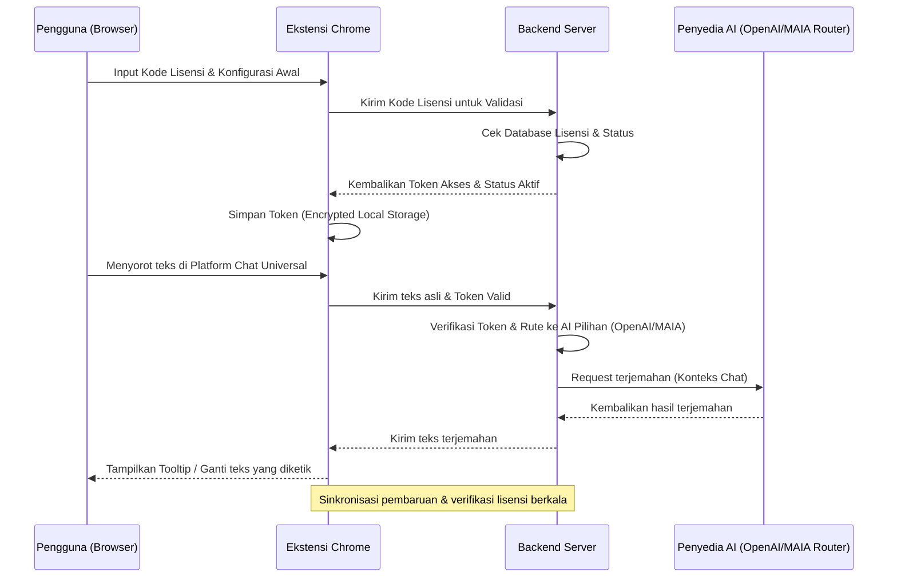
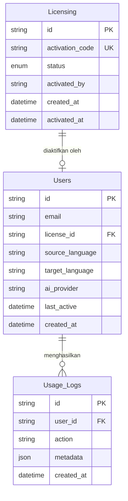

# PRD — Project Requirements Document

## 1. Overview
Sebagai *remote worker* atau pekerja lepas (freelancer) yang sering berkomunikasi dengan klien dari berbagai negara, hambatan bahasa sering menjadi penghalang produktivitas. Proses membuka tab penerjemah terpisah, menyalin, menerjemahkan, lalu menempelnya kembali memutus *flow* kerja dan memakan waktu. 

**FluentRemote** adalah ekstensi Google Chrome yang menyelesaikan masalah tersebut dengan memberikan terjemahan instan langsung di halaman web percakapan (*in-place translation*). Pengguna cukup menyorot (*highlight*) teks untuk membaca pesan asing, atau menyorot teks yang sedang diketik untuk langsung mengubahnya menjadi bahasa target secara otomatis. Aplikasi ini dirancang universal, kompatibel dengan semua platform chat berbasis web yang diakses melalui browser (Fiverr, Upwork, WhatsApp Web, Telegram Web, Facebook Messenger, Instagram DM, Slack Web, dll.). 

Model monetisasi yang diterapkan adalah *One-Time Purchase* (OTP) dengan sistem Lisensi/Kode Aktivasi. Pengguna cukup membeli satu kali untuk mendapatkan akses penuh tanpa biaya berlangganan bulanan, namun tetap berhak mendapatkan pembaruan fitur, peningkatan performa, dan perbaikan keamanan di masa depan.

## 2. Requirements
- **Platform:** Ekstensi Google Chrome yang kompatibel dengan semua website/web app berbasis pesan/chat yang dijalankan di browser, tidak terbatas pada platform freelance tertentu.
- **Pilihan Penyedia AI (Multi-Provider):** Mendukung dua jalur penerjemahan: **OpenAI API (GPT-4o-mini)** dan **MAIA Router**. Pengguna dapat memilih backend AI favoritnya langsung di pengaturan ekstensi.
- **UI/UX:** Desain bersih, modern, dan tidak mengganggu antarmuka website asli. Menggunakan *floating tooltip* atau *pop-up* minimalis yang muncul sesuai konteks saat teks disorot.
- **Fleksibilitas Bahasa:** Fitur "Your Language" untuk mengatur bahasa sumber (asal) dan bahasa target (tujuan). Dapat disesuaikan kapan saja sesuai kebutuhan percakapan.
- **Model Monetisasi & Lisensi (OTP):** Menggunakan sistem Kode Aktivasi yang diverifikasi oleh backend. Hanya pengguna dengan kode valid yang dapat mengaktifkan dan menggunakan ekstensi. Sistem mendukung verifikasi aman, penyimpanan token lokal, dan dukungan pembaruan software tanpa perlu aktivasi ulang.
- **Keamanan & Privasi Pengguna:** Implementasi enkripsi data sensitif, *hardware binding* anti-piracy, kebijakan *zero-log* untuk teks percakapan, komunikasi wajib HTTPS/TLS, *Content Security Policy* (CSP) anti-XSS, dan sanitasi teks otomatis sebelum proses *auto-replace*.

## 3. Core Features
- **Instant Read Translator:** Saat pengguna menyorot teks pesan di platform chat mana pun, *tooltip* modern muncul menampilkan terjemahan dalam bahasa target secara langsung, tanpa reload atau perpindahan tab.
- **Instant Write Translator:** Pengguna mengetik pesan dalam bahasa asal di kolom chat. Setelah selesai, ia menyorot teks tersebut. Satu klik pada *tooltip* akan otomatis menggantikan (*auto-replace*) teks asli dengan terjemahan bahasa target yang kontekstual dan profesional.
- **Language Preferences (Your Language):** Menu pengaturan cepat untuk memilih bahasa sumber & tujuan. Opsi ini fleksibel dan dapat diubah secara dinamis.
- **AI Provider Selector:** Pengaturan di dalam panel ekstensi untuk memilih penyedia layanan AI: OpenAI GPT-4o-mini atau MAIA Router. Backend akan merouting request sesuai pilihan pengguna.
- **License Activation & Verification:** Sistem masuk dengan Kode Aktivasi yang diverifikasi oleh server backend. Setelah aktif, ekstensi menyimpan token lisensi yang dienkripsi di penyimpanan lokal browser. Sistem dirancang untuk mendukung pembaruan otomatis (*update*) tanpa membatalkan status lisensi yang sudah aktif.

## 4. User Flow
1. **Instalasi:** Pengguna memasang "FluentRemote" dari Chrome Web Store atau versi developer.
2. **Aktivasi Lisensi (First Win):** Pengguna membuka panel pengaturan ekstensi, memasukkan Kode Aktivasi yang dibeli. Backend memverifikasi kevalidan kode. Jika berhasil, status berubah menjadi "Aktif" dan token akses tersimpan aman secara lokal.
3. **Konfigurasi Awal:** Pengguna memilih bahasa asal & tujuan, serta memilih penyedia AI (OpenAI atau MAIA Router).
4. **Membaca Pesan:** Pengguna membuka obrolan di platform favorit (misal: Instagram DM atau WhatsApp Web). Kontak mengirim pesan dalam bahasa asing. Pengguna menyorot pesan tersebut. Ekstensi memunculkan *tooltip* terjemahan instan.
5. **Membalas Pesan:** Pengguna mengetik balasan dalam bahasa Indonesia. Setelah selesai, ia menyorot teksnya. Klik "Terjemahkan & Ganti", teks langsung berubah ke bahasa target.
6. **Penggunaan & Update Jangka Panjang:** Ekstensi berjalan di semua tab chat yang dibuka. Pengguna akan menerima update keamanan dan fitur baru secara otomatis via Chrome Extension API. Tidak ada biaya berulang, hanya aktivasi awal yang diperlukan.

## 5. Architecture
Sistem terdiri dari Ekstensi Chrome (interaksi DOM & UI overlay), Backend Server (validasi lisensi, routing AI, manajemen update), dan Layanan AI terpilih (OpenAI/MAIA Router). Arsitektur dirancang agar aman, independen dari platform chat, dan siap untuk skalabilitas.

## 6. Database Schema
Database diperlukan untuk menyimpan data lisensi, profil pengguna, preferensi, dan log aktivitas untuk keperluan analitik serta pemantauan keamanan.

**Daftar Tabel:**
- **Licensing**: Menyimpan kode aktivasi dan status kepemilikan.
  - `id` (String, Primary Key)
  - `activation_code` (String, Unique) - Kode hash yang dibeli pengguna
  - `status` (Enum: 'available', 'activated', 'revoked')
  - `activated_by` (String, Nullable) - ID pengguna yang mengaktifkan
  - `created_at`, `activated_at` (Timestamp)
- **Users**: Menyimpan profil dan preferensi teknis pengguna.
  - `id` (String, Primary Key)
  - `email` (String)
  - `license_id` (String, Foreign Key ke Licensing)
  - `source_language` (String) - Bahasa asal
  - `target_language` (String) - Bahasa target
  - `ai_provider` (String: 'openai' atau 'maia_router')
  - `last_active` (Timestamp)
  - `created_at` (Timestamp)
- **Usage_Logs**: (Opsional untuk analitik & debugging)
  - `id` (String, Primary Key)
  - `user_id` (String, Foreign Key)
  - `action` (String: 'read_translate', 'write_translate', 'license_verify')
  - `metadata` (JSON) - Info tambahan (platform, jumlah karakter, dll)
  - `created_at` (Timestamp)

## 7. Tech Stack
Stack teknologi dipilih untuk memastikan performa tinggi, keamanan lisensi, kompatibilitas universal, dan kemudahan deployment.

- **Frontend (Ekstensi Browser):** React.js dengan **Tailwind CSS** dan **shadcn/ui**. Menggunakan `content-scripts` untuk manipulasi DOM yang aman dan overlay tooltip yang tidak bertabrakan dengan UI platform chat apa pun.
- **Backend (API, Lisensi & Routing):** **Next.js** (App Router) sebagai serverless API handler. Menangani validasi lisensi, abstraksi routing ke dua provider AI, dan manajemen pembaruan versi.
- **Database:** **SQLite** dengan **Drizzle ORM**. Ringan, cepat, dan sangat kompatibel dengan arsitektur serverless modern (deploy via Vercel, PlanetScale, atau Neon).
- **Keamanan & Lisensi:** **Better Auth** untuk identifikasi pengguna dasar. Untuk sistem OTP, menggunakan `bcrypt`/`argon2` pada backend dan penyimpanan token sesi yang dienkripsi menggunakan `Web Crypto API` di `chrome.storage.local`. Mekanisme update dirancang independen dari status lisensi agar pengguna aktif selalu mendapat patch terbaru tanpa aktivasi ulang.
- **Layanan AI / Terjemahan:** 
  - **OpenAI API** (`gpt-4o-mini`) untuk hasil terjemahan yang sangat kontekstual, memahami slang, dan struktur chat natural.
  - **MAIA Router** sebagai alternatif/opsi kedua. Backend mengimplementasikan adapter pattern agar pergantian penyedia di frontend hanya mengubah routing request tanpa mengubah logika aplikasi.
- **Deployment & CI/CD:** Vercel (Backend & Landing Page), Chrome Web Store (Ekstensi), GitHub Actions untuk build otomatis dan distribusi update versi.

## 8. Security & Privacy
Sistem FluentRemote dibangun dengan prinsip *Security by Design* untuk melindungi data pengguna, mencegah penyalahgunaan lisensi, dan mematuhi standar privasi modern. Berikut adalah spesifikasi teknis keamanan yang diimplementasikan:

1. **Enkripsi Data Sensitif (Web Crypto API)**
   - Token lisensi, preferensi pengaturan, dan data sesi tidak akan pernah disimpan dalam bentuk *plaintext* di `chrome.storage.local`.
   - Backend menghasilkan sesi kriptografi saat aktivasi berhasil. Ekstensi menggunakan **Web Crypto API** (AES-GCM) untuk mengenkripsi data sebelum ditulis ke penyimpanan lokal browser. Kunci enkripsi (*key handle*) disimpan dalam memori runtime dan dibuang saat ekstensi dimatikan atau di-*update*.

2. **Hardware Binding (Anti-Piracy)**
   - Setiap Kode Aktivasi yang berhasil diverifikasi akan diikat (*bound*) secara kriptografis ke *fingerprint* unik perangkat/browser pengguna.
   - *Fingerprint* terdiri dari kombinasi aman `chrome.runtime.id`, hash `navigator.userAgent`, dan ID profil Chrome. Backend mencatat hash ini saat aktivasi pertama. Jika kode yang sama coba aktifkan di perangkat/tab profil lain, backend akan menolak permintaan atau memicu mekanisme *re-binding* yang memerlukan verifikasi email/OTP tambahan.
   - Mencegah distribusi ilegal satu kode ke banyak pengguna secara masal.

3. **Zero-Log Policy (Privasi Teks Percakapan)**
   - Teks asli yang dikirim oleh pengguna untuk diterjemahkan **tidak akan disimpan secara permanen** di database backend atau log server.
   - Alur pemrosesan: `EKstensi -> Backend (cache memori sementara) -> AI Provider -> Hapus dari cache`. Data teks hanya diproses dalam RAM server selama permintaan berlangsung dan di-*garbage collected* segera setelah respons dikirim kembali ke klien.
   - Log aktivitas (`Usage_Logs`) hanya mencatat metadata tanpa isi teks: waktu, tipe aksi (`read`/`write`), panjang karakter, platform target, dan status latensi. Ini memastikan kepatuhan penuh terhadap standar privasi data percakapan.

4. **Secure Communication (HTTPS/TLS Enforcement)**
   - Semua komunikasi antar komponen (`Ekstensi <-> Backend`, `Backend <-> AI Provider`, `Ekstensi <-> Chrome Web Store`) wajib menggunakan protokol **HTTPS/TLS 1.2+**.
   - Backend mengimplementasikan *Strict Transport Security (HSTS)* dan *Certificate Pinning* opsional pada ekstensi untuk mencegah serangan *Man-in-the-Middle* (MitM) atau pengalihan (*redirect*) ke server jahat selama proses validasi lisensi dan pengiriman teks terjemahan.

5. **Content Security Policy (CSP) & Mitigasi XSS**
   - Ekstensi akan menerapkan kebijakan **Content Security Policy (CSP)** yang ketat melalui `manifest.json` (`manifest_version: 3`).
   - Kebijakan membatasi hanya asal (*origin*) tepercaya yang diperbolehkan untuk memuat skrip, gaya, atau aset eksternal: `default-src 'self'; script-src 'self'; style-src 'self' 'unsafe-inline'; connect-src 'self' https://api.fluentremote.id https://api.openai.com https://router.maia.ai;`
   - Ini secara efektif menonaktifkan kemampuan *inline scripts* dan mencegah serangan *Cross-Site Scripting* (XSS) yang mungkin muncul dari interaksi overlay dengan DOM halaman chat web pihak ketiga.

6. **Sanitasi Teks (Input/Output Cleaning)**
   - Sebelum teks hasil terjemahan dikirim kembali ke kolom input chat (fitur *auto-replace*), sistem menjalankan pipeline sanitasi dua lapis:
     - **Lapisan 1 (Backend):** Hasil dari AI diproses untuk menghapus karakter kontrol tidak valid, emoji terfragmentasi, atau format markdown yang rusak.
     - **Lapisan 2 (Ekstensi):** Menggunakan pustaka sanitasi DOM (`DOMPurify` atau implementasi regex aman) untuk membersihkan string sebelum disisipkan ke `contentEditable` atau `<textarea>`.
   - Mencegah injeksi kode berbahaya (HTML/JS), *keylogging* tidak sah, atau kerusakan layout pada platform chat target akibat konten penerjemahan yang tidak terduga.